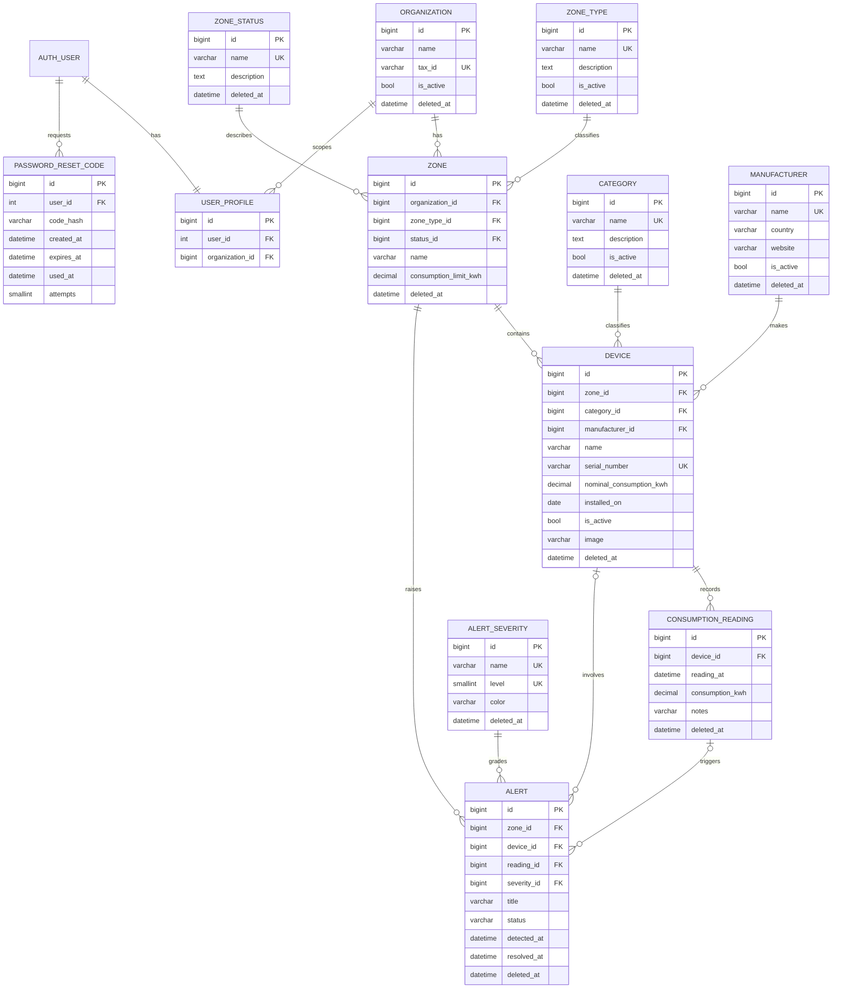

# EcoEnergy

Aplicación web Django para monitorear el consumo energético de las zonas y
dispositivos de varias organizaciones. Cada usuario trabaja solo con los datos
de su organización (scoping), según los permisos de su rol.

Proyecto de la asignatura **Programación Back End (INACAP)**:

- **Evaluación Unidad II**: aplicación web, Django Admin, permisos y despliegue.
- **Evaluación Sumativa 3**: API RESTful con Django REST Framework y JWT
  (sección [API REST](#api-rest-evaluación-3)).

| Evidencia | Valor |
|---|---|
| Repositorio | https://github.com/JuanDuran-lab/ecoenergy-fase1 |
| Rama de trabajo de la API | `feature/api-drf-jwt` (integrada a `main` por Pull Request) |
| Commit evaluado | Se informa en la entrega (`git rev-parse --short HEAD`) |
| Usuarios de prueba | `admin_demo`, `supervisor_norte`, `lector_sur`, `invitado_centro` (contraseñas entregadas al docente, no publicadas) |
| Colección Apidog | [`docs/apidog/`](docs/apidog/) |
| Despliegue AWS Academy (Unidad II) | http://13.218.34.129/ |

> La Evaluación 3 no exige despliegue: la API se demuestra en el servidor
> local. La instancia EC2 corre en el AWS Academy Learner Lab; si el
> laboratorio se reinicia, la IP pública puede cambiar (ver
> [`docs/DEPLOY_AWS.md`](docs/DEPLOY_AWS.md)).

---

## Tabla de contenidos

1. [Tecnologías](#tecnologías)
2. [Estructura del proyecto](#estructura-del-proyecto)
3. [Instalación local](#instalación-local)
4. [Variables de entorno](#variables-de-entorno)
5. [Migraciones y carga de datos](#migraciones-y-carga-de-datos)
6. [API REST (Evaluación 3)](#api-rest-evaluación-3)
7. [Pruebas con Apidog](#pruebas-con-apidog)
8. [Modelo de datos](#modelo-de-datos)
9. [Usuarios, roles y permisos](#usuarios-roles-y-permisos)
10. [Funcionalidades y dónde está el código](#funcionalidades-y-dónde-está-el-código)
11. [Pruebas automatizadas](#pruebas-automatizadas)
12. [Despliegue en AWS Academy](#despliegue-en-aws-academy)
13. [Guion de demostración](#guion-de-demostración)
14. [Flujo de trabajo con Git](#flujo-de-trabajo-con-git)

---

## Tecnologías

| Componente | Uso |
|---|---|
| Python 3.12 + Django 6.1 | Framework back end |
| Django REST Framework 3.18 | API REST: serializers, ViewSets, rutas, paginación |
| Simple JWT 5.5 | Autenticación de la API con tokens access/refresh |
| drf-spectacular 0.30 | Documentación OpenAPI 3 y Swagger UI en `/api/docs/` |
| SQLite (por defecto) / PostgreSQL | Base de datos, elegida por variable de entorno |
| python-dotenv | Carga del archivo `.env` |
| Pillow | Validación del contenido real de las imágenes |
| openpyxl | Exportación a Excel (.xlsx) |
| Bootstrap 5 + Bootstrap Icons | Interfaz web (CDN) |
| SweetAlert2 | Confirmación de eliminación (CDN) |
| Gunicorn + Nginx | Servidor de aplicación y servidor web en AWS |
| Apidog | Pruebas de la API (colección en `docs/apidog/`) |

## Estructura del proyecto

```
ecoenergy/            Configuración (settings por variables de entorno, urls, wsgi)
api/                  API REST (Evaluación 3)
  permissions.py      ApiRolePermission: rol API por grupo (lectura / escritura / 403)
  serializers.py      Serializers con campos explícitos y validaciones (400)
  views.py            ViewSets con scoping por organización y borrado lógico
  urls.py             Rutas /api/ (DefaultRouter) y endpoints JWT
  pagination.py       20 por página, ?page= y ?page_size= (máx. 100)
  exceptions.py       Errores en JSON (404 sin revelar otra organización, 500 genérico)
  schema.py           Documentación OpenAPI: resúmenes, filtros y respuestas de error
  tests.py            33 pruebas de la API
core/                 Código transversal, reutilizado por las demás apps
  models.py           SoftDeleteModel: created_at, updated_at, deleted_at + managers
  scoping.py          Filtro de QuerySets por organización del usuario (web, Admin y API)
  mixins.py           ModelPermissionMixin y OrganizationScopedMixin
  views.py            Vistas base de CRUD (listar, ver, crear, editar, eliminar lógico)
  pagination.py       Paginación web 5/15/30 guardada en request.session
  admin.py            Admin con borrado lógico, filtro de eliminados y restaurar
accounts/             Autenticación y seguridad web
  models.py           UserProfile (organización) y PasswordResetCode (código 6 dígitos)
  validators.py       PasswordComplexityValidator
  forms.py / views.py Login, logout y recuperación de contraseña
monitoring/           Negocio: zonas, dispositivos, lecturas y alertas
  models.py           6 tablas maestras + 4 operacionales
  forms.py            ModelForm con validaciones de servidor
  views/              Una vista por entidad (zones, devices, readings, alerts, dashboard)
  management/commands/seed_data.py   Carga de 2.186 registros, roles y usuarios
  management/commands/resumen_datos.py   Cantidades por modelo y usuarios (demo)
deploy/               Gunicorn (systemd), Nginx y script de actualización
docs/                 Diagrama ER, guía de despliegue y colección Apidog
  apidog/             Colección, entorno, matriz de pruebas y esquema OpenAPI
```

## Instalación local

Requisitos: **Python 3.12 o superior** y Git.

**Windows (PowerShell)**

```powershell
git clone https://github.com/JuanDuran-lab/ecoenergy-fase1.git
cd ecoenergy-fase1
python -m venv .venv
.\.venv\Scripts\Activate.ps1
pip install -r requirements.txt
Copy-Item .env.example .env      # luego completar DJANGO_SECRET_KEY y las contraseñas SEED_*
python manage.py migrate
python manage.py seed_data
python manage.py runserver
```

**Linux / macOS**

```bash
git clone https://github.com/JuanDuran-lab/ecoenergy-fase1.git
cd ecoenergy-fase1
python3 -m venv .venv
source .venv/bin/activate
pip install -r requirements.txt
cp .env.example .env             # luego completar DJANGO_SECRET_KEY y las contraseñas SEED_*
python manage.py migrate
python manage.py seed_data
python manage.py runserver
```

- Aplicación web: <http://127.0.0.1:8000/>
- API REST: <http://127.0.0.1:8000/api/> (requiere token, ver más abajo)
- Documentación de la API: <http://127.0.0.1:8000/api/docs/> (pública)

> Si `.\.venv\Scripts\Activate.ps1` está bloqueado en Windows, ejecutar antes
> `Set-ExecutionPolicy -Scope Process -ExecutionPolicy Bypass`.
>
> Si la base ya tenía datos de una versión anterior, usar
> `python manage.py seed_data --reset` para recargarla.

Comprobaciones opcionales después de instalar:

```bash
python manage.py check
python manage.py makemigrations --check --dry-run   # "No changes detected"
python manage.py test                               # 118 pruebas
python manage.py resumen_datos                      # modelos, total y usuarios
```

## Variables de entorno

Se definen en `.env` (copiado desde `.env.example`). El archivo `.env` está en
`.gitignore` y **nunca** se sube al repositorio.

| Variable | Obligatoria | Descripción |
|---|---|---|
| `DJANGO_SECRET_KEY` | Sí en producción | Clave secreta de Django (también firma los JWT) |
| `DJANGO_DEBUG` | No (False) | `True` solo en desarrollo |
| `DJANGO_ALLOWED_HOSTS` | Sí en producción | Hosts permitidos, separados por coma |
| `DJANGO_CSRF_TRUSTED_ORIGINS` | En AWS | Ej: `http://<IP_PUBLICA>` |
| `DJANGO_USE_HTTPS` | No (False) | Activa cookies seguras si hay HTTPS |
| `DJANGO_MEDIA_ROOT` | No | Carpeta de imágenes subidas (por defecto `media/`) |
| `DB_ENGINE` | No (`sqlite`) | `sqlite` o `postgresql` |
| `DB_NAME`, `DB_USER`, `DB_PASSWORD`, `DB_HOST`, `DB_PORT` | Solo PostgreSQL | Conexión a la base |
| `SEED_ADMIN_PASSWORD`, `SEED_SUPERVISOR_PASSWORD`, `SEED_READER_PASSWORD`, `SEED_GUEST_PASSWORD` | Sí para `seed_data` | Contraseñas de los 4 usuarios de prueba |
| `SEED_ADMIN_EMAIL`, `SEED_SUPERVISOR_EMAIL`, `SEED_READER_EMAIL`, `SEED_GUEST_EMAIL` | No | Correos de los usuarios de prueba |
| `JWT_ACCESS_MINUTES` | No (30) | Duración del access token, en minutos |
| `JWT_REFRESH_DAYS` | No (1) | Duración del refresh token, en días |
| `EMAIL_HOST`, `EMAIL_PORT`, `EMAIL_HOST_USER`, `EMAIL_HOST_PASSWORD`, `EMAIL_USE_TLS` | No | SMTP. Sin `EMAIL_HOST`, el correo se imprime en la consola |
| `DEFAULT_FROM_EMAIL` | No | Remitente de los correos |

Las contraseñas `SEED_*` deben cumplir la política del proyecto: mínimo 10
caracteres, mayúscula, minúscula, número y carácter especial.

## Migraciones y carga de datos

```bash
python manage.py migrate            # crea las tablas y los permisos
python manage.py seed_data          # carga inicial (base vacía)
python manage.py seed_data --reset  # borra los datos de negocio y recarga
```

`seed_data` es reproducible (semilla aleatoria fija) y no requiere ingresar
nada a mano. Genera:

| Datos | Cantidad |
|---|---|
| Organizaciones | 3 |
| Otras tablas maestras | 26 (6 categorías, 5 tipos de zona, 3 estados, 8 fabricantes, 4 severidades) |
| Zonas | 24 (8 por organización) |
| Dispositivos | 120 (40 por organización) |
| Lecturas de consumo | 1.800 (600 por organización, últimos 45 días) |
| Alertas | 213 (derivadas de lecturas sobre el consumo nominal) |
| **Total registros de negocio** | **2.186** |

También crea los grupos (roles web y roles API) y los 4 usuarios de prueba.
Las contraseñas se leen del `.env` y se validan con la política de
contraseñas antes de crearlos. Al terminar, el comando imprime el resumen.

## API REST (Evaluación 3)

API RESTful con **Django REST Framework** y **Simple JWT**. Todas las rutas
están bajo `/api/`, responden JSON y exigen un token JWT de un usuario con
rol API.

### Los seis modelos de la API

| Tipo | Modelo (tabla) | Ruta | Relaciones |
|---|---|---|---|
| Principal | `Zone` (`zone`) | `/api/zonas/` | N:1 `Organization`, N:1 `ZoneType`, N:1 `ZoneStatus`; 1:N `Device`, 1:N `Alert` |
| Principal | `Device` (`device`) | `/api/dispositivos/` | N:1 `Zone`, N:1 `Category`, N:1 `Manufacturer`; 1:N `ConsumptionReading`, 1:N `Alert` |
| Principal | `Manufacturer` (`manufacturer`) | `/api/fabricantes/` | 1:N `Device` |
| Principal | `Category` (`category`) | `/api/categorias/` | 1:N `Device` |
| Operacional | `ConsumptionReading` (`consumption_reading`) | `/api/lecturas/` | N:1 `Device` |
| Operacional | `Alert` (`alert`) | `/api/alertas/` | N:1 `Zone`, N:1 `Device` (opcional), N:1 `ConsumptionReading` (opcional), N:1 `AlertSeverity` |

Los seis tienen datos cargados (ver [carga de datos](#migraciones-y-carga-de-datos)).
Zonas, dispositivos, lecturas y alertas pertenecen a una organización (a través
de la zona) y aplican scoping. Fabricantes y categorías son **catálogos
compartidos** por todas las organizaciones.

`Organization` no está entre los modelos principales de la API: el
administrador API trabaja dentro de su propia organización, por lo que crear
o eliminar organizaciones no corresponde a su rol.

### Endpoints y métodos

| Ruta | Métodos | Descripción |
|---|---|---|
| `POST /api/token/` | POST | Usuario y contraseña → `access` y `refresh` |
| `POST /api/token/refresh/` | POST | `refresh` → nuevo `access` |
| `/api/` | GET | Índice con las rutas de los recursos |
| `/api/zonas/` | GET, POST | Lista paginada / crear |
| `/api/zonas/{id}/` | GET, PUT, PATCH, DELETE | Detalle / reemplazar / modificar / eliminar |
| `/api/dispositivos/` y `/api/dispositivos/{id}/` | GET, POST, PUT, PATCH, DELETE | Ídem |
| `/api/fabricantes/` y `/api/fabricantes/{id}/` | GET, POST, PUT, PATCH, DELETE | Ídem |
| `/api/categorias/` y `/api/categorias/{id}/` | GET, POST, PUT, PATCH, DELETE | Ídem |
| `/api/lecturas/` y `/api/lecturas/{id}/` | GET | Solo lista y detalle |
| `/api/alertas/` y `/api/alertas/{id}/` | GET | Solo lista y detalle |
| `/api/docs/` | GET | Documentación interactiva (Swagger UI), pública |
| `/api/schema/` | GET | Esquema OpenAPI 3 (YAML; `?format=json` para JSON), público |

Filtros opcionales en las listas: `?search=texto` (por nombre, serie, título,
según el recurso), `/api/dispositivos/?zone=<id>`, `/api/lecturas/?device=<id>`
y `/api/alertas/?status=open|in_progress|resolved`.

Todas las rutas aceptan la URL **con o sin barra final** (`/api/token/` y
`/api/token`). Una ruta que no existe bajo `/api/` (por ejemplo
`/api/zonass/`) responde **404 en JSON**, igual que cualquier otro error.

### Autenticación JWT

1. `POST /api/token/` con `{"username": "...", "password": "..."}` entrega
   `access` (30 minutos) y `refresh` (1 día).
2. Cada solicitud a un recurso envía el header
   `Authorization: Bearer <access>`.
3. Cuando el `access` vence, `POST /api/token/refresh/` con
   `{"refresh": "..."}` entrega uno nuevo.

La API usa **solo JWT** como autenticación (no la sesión de la web), por eso
una solicitud sin token o con token inválido responde **401**.

### Roles de la API

El rol API es el grupo del usuario (`api/permissions.py`). Ningún usuario de
la demostración es superusuario.

| Usuario | Rol API | Organización | GET | POST / PUT / PATCH / DELETE |
|---|---|---|---|---|
| `supervisor_norte` | Administrador API | EcoEnergy Norte | 200 | Permitido (201 / 200 / 204) |
| `lector_sur` | Operador API | EcoEnergy Sur | 200 | **403** |
| `invitado_centro` | (sin rol API) | EcoEnergy Centro | **403** | **403** |
| Sin token | — | — | **401** | **401** |

El orden de los controles es: autenticación JWT (401) → rol API (403) →
scoping por organización (404).

### Scoping por organización

Igual que en la web y el Admin (`core/scoping.py`): cada usuario ve solo las
zonas, dispositivos, lecturas y alertas de su organización. Un registro de
otra organización no aparece en las listas, y pedir, modificar o eliminar su
id responde **404** con el mismo mensaje que un id inexistente, para no
revelar qué existe fuera de su organización. Al crear, la organización de la
zona se asigna automáticamente y la zona de un dispositivo debe ser de la
organización del usuario.

### Códigos de estado

| Estado | Cuándo |
|---|---|
| 200 | Consulta (GET), actualización (PUT/PATCH), obtener o renovar token |
| 201 | Creación (POST) |
| 204 | Eliminación (DELETE, borrado lógico) |
| 400 | Datos inválidos (validaciones) o JSON mal formado |
| 401 | Sin token, token inválido o vencido, credenciales incorrectas |
| 403 | Usuario autenticado sin rol API, u Operador API que intenta escribir |
| 404 | Id inexistente, registro de otra organización, página fuera de rango o ruta inexistente bajo `/api/` |
| 405 | Método no permitido (por ejemplo, POST en lecturas o alertas) |
| 409 | Eliminar un fabricante o categoría que tiene dispositivos |
| 500 | Error inesperado del servidor: mensaje genérico en JSON; el detalle queda en el log |

Todas las respuestas, incluidos los errores, son JSON con la forma
`{"detail": "..."}` o, en los 400, `{"campo": ["mensaje"]}`. La lista completa de
respuestas de cada endpoint está documentada en `/api/docs/`.

### Validaciones (400)

Los serializers (`api/serializers.py`) reutilizan las reglas de los modelos y
de los formularios web:

| Tipo | Regla | Ejemplo de respuesta |
|---|---|---|
| De campo | Número de serie: solo mayúsculas, números y guiones (4 a 40) | `{"serial_number": ["Solo mayúsculas, números y guiones (4 a 40 caracteres)."]}` |
| De campo | La fecha de instalación no puede ser futura | `{"installed_on": ["La fecha de instalación no puede ser futura."]}` |
| De campo | Consumo y límite en kWh dentro de rango (mayor que 0) | `{"consumption_limit_kwh": ["Asegúrese de que este valor es mayor o igual a 0.01."]}` |
| De relación | La zona del dispositivo debe ser de la organización del usuario | `{"zone": ["El registro 12 no existe o no pertenece a tu organización."]}` |
| De relación | Categoría y fabricante deben estar activos | `{"category": ["La categoría está inactiva."]}` |
| Regla de negocio | Número de serie único; nombre único por zona u organización | `{"serial_number": ["Ya existe un dispositivo con este número de serie."]}` |

### Eliminación lógica

`DELETE` no borra la fila: marca `deleted_at` (como en la web) y responde
**204**. El registro deja de aparecer en las listas y su detalle responde
**404**. Se conserva para auditoría y se puede restaurar desde el Django Admin
(filtro "Eliminados (lógico)"). Eliminar una zona elimina también sus
dispositivos, lecturas y alertas; eliminar un dispositivo, sus lecturas y
alertas. Un fabricante o categoría con dispositivos no se elimina (**409**);
se puede marcar como inactivo con `PATCH {"is_active": false}`.

### Paginación

Todas las listas están paginadas: **20 registros por página**.

- Otra página: `?page=2`
- Otro tamaño: `?page_size=50` (máximo 100)

```json
{
  "count": 600,
  "total_pages": 30,
  "page": 2,
  "page_size": 20,
  "next": "http://127.0.0.1:8000/api/lecturas/?page=3",
  "previous": "http://127.0.0.1:8000/api/lecturas/",
  "results": [ ... ]
}
```

El recurso más voluminoso es `/api/lecturas/` (1.800 lecturas, 600 por
organización).

## Pruebas con Apidog

Archivos en [`docs/apidog/`](docs/apidog/):

| Archivo | Contenido |
|---|---|
| `EcoEnergy_API.postman_collection.json` | Colección de 58 solicitudes en 7 carpetas, con verificaciones |
| `EcoEnergy_local.postman_environment.json` | Entorno `EcoEnergy local`: `baseUrl`, usuarios, contraseñas **vacías** y variables que llenan los scripts |
| `MATRIZ_PRUEBAS.md` | Matriz de evidencias: URL, método, identidad, estado esperado y observado, respuesta representativa |
| `openapi.yaml` | Esquema OpenAPI 3 de la API (el mismo de `/api/schema/`), opcional para importar como documentación |

### Importar y ejecutar

1. Levantar el servidor local con los datos cargados (`seed_data`).
2. En Apidog: **Settings → Import Data → Postman** e importar los dos
   archivos (colección y entorno).
3. Seleccionar el entorno **EcoEnergy local** y completar las contraseñas en
   la columna de valor local. Cada variable corresponde al usuario del mismo
   nombre:

   | Variable del entorno | Usuario | Valor (del `.env`) |
   |---|---|---|
   | `supervisor_password` | `supervisor_norte` (Administrador API) | `SEED_SUPERVISOR_PASSWORD` |
   | `lector_password` | `lector_sur` (Operador API) | `SEED_READER_PASSWORD` |
   | `invitado_password` | `invitado_centro` (sin rol API) | `SEED_GUEST_PASSWORD` |

   `SEED_ADMIN_PASSWORD` (de `admin_demo`, superusuario) no se usa en Apidog.
4. Ejecutar las carpetas **en orden** (01 a 07). La carpeta 01 obtiene los
   tokens y los guarda en variables del entorno; las demás los usan como
   `Bearer`. El access dura 30 minutos: si aparecen 401 inesperados, volver
   a ejecutar la carpeta 01.

Para ejecutar todo de una vez: módulo **Pruebas → Escenarios de Prueba →
Nuevo**, agregar paso **Importar desde Caso de Depuración de Endpoint**,
marcar `EcoEnergy API REST (EVA 3)` (58), revisar que el orden siga las
carpetas y **Ejecutar** con el entorno **EcoEnergy local**. El resultado
queda en **Informes de Prueba**.

> **Validación automática de Apidog.** Apidog compara cada respuesta con la
> primera respuesta documentada del endpoint (normalmente 200), por lo que
> marca como "fallidos" los pasos que esperan 401, 403, 404 o 409 aunque
> todas las aserciones pasen. Para un informe en verde, desactivar
> **Validate Response** en la configuración del proyecto de Apidog; las
> verificaciones de la colección (`pm.test`) siguen comprobando cada estado.

Cada solicitud indica en su descripción la identidad y el estado esperado, y
trae scripts de verificación (`pm.test`) que comprueban el estado y el cuerpo
de la respuesta.

| Carpeta | Comprueba |
|---|---|
| 01 JWT | Token de los 3 usuarios (200), renovar access (200), credenciales incorrectas (401), token sin barra final (200) |
| 02 Autenticación y roles | Sin token y token inválido (401), operador GET (200) y POST (403), sin rol API (403) |
| 03 Cobertura de modelos | GET lista y GET detalle de los 6 recursos (200) |
| 04 CRUD principales | POST (201), GET (200), PATCH (200), PUT (200) y DELETE (204) de zona, dispositivo, fabricante y categoría; GET tras eliminar (404) |
| 05 Validaciones y errores | 2 validaciones de campo, 1 de relación, 1 regla de negocio (400), ruta inexistente (404 JSON), id inexistente (404), catálogo en uso (409) |
| 06 Paginación | Páginas 1 y 2 de lecturas con resultados distintos, `page_size` (200) |
| 07 Scoping por organización | GET y PATCH de una zona de otra organización (404) |

La colección captura los ids en cada ejecución (no hay ids fijos), así
funciona con cualquier base recién cargada y se puede repetir sin recargar:
los registros que crea llevan un sufijo distinto en cada corrida y se
eliminan al final de la carpeta 04.

> Antes de exportar el entorno o tomar capturas, verificar que no queden
> tokens ni contraseñas visibles: después de una ejecución, el entorno guarda
> los tokens y las contraseñas en sus valores actuales.

### Problemas frecuentes

| Síntoma | Causa y solución |
|---|---|
| `RuntimeError: No se encontró el archivo .env` | Falta el `.env`: `Copy-Item .env.example .env` (Windows) o `cp .env.example .env` y completarlo |
| `seed_data`: "Faltan valores en .../.env" | Las contraseñas `SEED_*` se escribieron en `.env.example` o no se guardó el `.env`. Editar el `.env` y guardar |
| `git status` limpio después de editar el `.env` | Es lo esperado: el `.env` está en `.gitignore` y nunca se sube |
| Apidog: 401 "No se encontró una cuenta de usuario activa" al pedir el token | La contraseña no corresponde al usuario: revisar la tabla del paso 3. Si sigue, `python manage.py seed_data --reset` recrea los usuarios con las contraseñas actuales del `.env` |
| Apidog: 401 en solicitudes que antes daban 200 | El access venció (30 min): ejecutar de nuevo la carpeta 01 |

## Modelo de datos

Nombres técnicos de modelos, tablas (`db_table`) y campos en **inglés**
(snake_case para tablas y campos, PascalCase para modelos). Las etiquetas
visibles (`verbose_name`) están en español.

| Tipo | Modelo (tabla) | Descripción |
|---|---|---|
| Maestra | `Organization` (`organization`) | Empresa/sucursal; define el scoping |
| Maestra | `Category` (`category`) | Categoría de dispositivo |
| Maestra | `ZoneType` (`zone_type`) | Tipo de zona |
| Maestra | `ZoneStatus` (`zone_status`) | Estado operativo de la zona |
| Maestra | `Manufacturer` (`manufacturer`) | Fabricante del dispositivo |
| Maestra | `AlertSeverity` (`alert_severity`) | Severidad de alerta (nivel 1–4 y color) |
| Operacional | `Zone` (`zone`) | Zona con límite de consumo |
| Operacional | `Device` (`device`) | Dispositivo con número de serie e imagen |
| Operacional | `ConsumptionReading` (`consumption_reading`) | Lectura de consumo en kWh |
| Operacional | `Alert` (`alert`) | Alerta de consumo por zona/dispositivo/lectura |
| Apoyo | `UserProfile` (`user_profile`) | Usuario ↔ organización (OneToOne con `User`) |
| Apoyo | `PasswordResetCode` (`password_reset_code`) | Código de recuperación hasheado |

La clasificación anterior es la de la Unidad II (Django Admin). Para la API de
la Evaluación 3, los modelos principales y operacionales son los de la
[tabla de la API](#los-seis-modelos-de-la-api).

Todas las entidades de negocio heredan de `core.models.SoftDeleteModel`:

- `objects` (manager por defecto) **oculta** los registros con `deleted_at`.
- `all_objects` incluye los eliminados (lo usa el Admin para el filtro "Eliminados").
- `delete()` de instancias y QuerySets se convierte en borrado lógico.
- Unicidades (`UniqueConstraint`) condicionadas a `deleted_at IS NULL`, para
  poder reutilizar un nombre después de eliminar un registro.
- Cascada lógica: eliminar una zona elimina sus dispositivos, lecturas y
  alertas; eliminar un dispositivo elimina sus lecturas y alertas.



## Usuarios, roles y permisos

| Usuario | Rol web (grupo) | Rol API (grupo) | Organización | Permisos |
|---|---|---|---|---|
| `admin_demo` | Administrador (superusuario) | — | Todas | Todo, incluido el Django Admin de todas las tablas. No se usa para demostrar la API |
| `supervisor_norte` | Supervisor | Administrador API | EcoEnergy Norte | Web: CRUD de zonas, dispositivos, lecturas y alertas, exportar, Admin con scoping. API: lectura y escritura |
| `lector_sur` | Lector | Operador API | EcoEnergy Sur | Web: solo ver y exportar. API: solo lectura |
| `invitado_centro` | — | — | EcoEnergy Centro | Puede autenticarse, pero no tiene rol API: la API responde 403 |

Las contraseñas **no se publican**: se entregan al docente para la demostración.

Seguridad aplicada en cada vista web (`core/mixins.py`):

1. Sin sesión → redirige al login.
2. Con sesión pero sin el permiso (`view`, `add`, `change`, `delete` o
   `export_consumptionreading`) → **403**.
3. Con permiso → `get_queryset()` filtra por organización: un registro de otra
   organización responde **404**, tanto al ver como al editar, eliminar o exportar.
4. En los formularios, los `<select>` de zona y dispositivo solo muestran
   registros de la organización. Un id ajeno enviado a mano es rechazado.

La seguridad de la API se describe en [Roles de la API](#roles-de-la-api).

## Funcionalidades y dónde está el código

| Requerimiento | Implementación |
|---|---|
| Configuración por variables de entorno | `ecoenergy/settings.py`, `.env.example` |
| Configuración de DRF y Simple JWT | `REST_FRAMEWORK` y `SIMPLE_JWT` en `ecoenergy/settings.py` |
| Serializers con campos explícitos | `api/serializers.py` |
| ViewSets y rutas `/api/` | `api/views.py`, `api/urls.py` |
| Roles API (401 / 403) | `api/permissions.py` |
| Scoping en la API (404) | `get_queryset()` de `api/views.py` con `core/scoping.py` |
| Paginación de la API | `api/pagination.py` |
| Documentación OpenAPI y Swagger UI | `api/schema.py`, `SPECTACULAR_SETTINGS` en settings, rutas en `api/urls.py` |
| Errores en JSON (404 de ruta, 500) | `api/exceptions.py`, `api_not_found` en `api/views.py` |
| 6 maestras + 4 operacionales en inglés | `monitoring/models.py` |
| Django Admin coherente | `monitoring/admin.py`, `accounts/admin.py`, `core/admin.py` (scoping, inline, acciones, filtro de eliminados, restaurar) |
| Borrado lógico | `core/models.py` (`SoftDeleteModel`), cascada en `Zone.soft_delete()` y `Device.soft_delete()` |
| 2.000+ registros reproducibles | `monitoring/management/commands/seed_data.py` |
| Resumen de datos y usuarios | `monitoring/management/commands/resumen_datos.py` |
| Login / logout | `accounts/views.py` (`LoginView`, `LogoutView` por POST) |
| Recuperación con código de 6 dígitos | `accounts/models.py` (`PasswordResetCode`), `accounts/forms.py`, `accounts/views.py` |
| Política de contraseñas | `AUTH_PASSWORD_VALIDATORS` en settings + `accounts/validators.py` |
| Permisos y scoping web | `core/mixins.py`, `core/scoping.py` |
| 4 CRUD web con ModelForm | `core/views.py` (bases), `monitoring/views/*.py`, `monitoring/forms.py` |
| Validaciones de servidor | `monitoring/forms.py` (duplicados, reglas) y `clean()` en `monitoring/models.py` |
| Imagen con validación real | `monitoring/validators.py`, campo `Device.image`, formulario multipart |
| Paginación web 5/15/30 en sesión | `core/pagination.py`, `core/templates/core/partials/pagination.html` |
| SweetAlert2 + POST/CSRF + soft delete | `core/static/core/js/confirm-delete.js`, `core/views.py` (`ScopedSoftDeleteView`) |
| Exportación a Excel | `monitoring/exports.py`, `ReadingExportView` en `monitoring/views/readings.py` |

### Recuperación de contraseña

1. `/cuentas/recuperar/`: el usuario ingresa su correo. La respuesta es la
   misma exista o no el correo, para no revelar usuarios registrados.
2. Se genera un código de 6 dígitos con `secrets`, se guarda **hasheado**
   (`make_password`) y se envía por correo. Expira en 10 minutos; pedir un
   código nuevo invalida el anterior.
3. `/cuentas/recuperar/confirmar/`: código + nueva contraseña dos veces
   (`SetPasswordForm`, que aplica todos los validadores y guarda con hash).
4. Al cambiar la contraseña, el código se marca como usado (`used_at`) y ya no
   sirve. Tras 5 intentos fallidos el código se bloquea.

### Exportación a Excel (investigación)

Se usa **openpyxl**: se crea un `Workbook` en memoria, se escribe una fila de
encabezados y una fila por cada lectura del QuerySet, se aplican formatos
(fecha, números, filtros, panel fijo) y se guarda en un `BytesIO` que se
devuelve con `Content-Type` de Excel y `Content-Disposition: attachment`.
El QuerySet es el mismo del listado: sin eliminados, con scoping por
organización y con los filtros activos. Una segunda hoja registra quién
exportó, cuándo, el alcance y los filtros.

## Pruebas automatizadas

```bash
python manage.py test
```

**118 pruebas**:

- **API (33, `api/tests.py`)**: obtener y renovar token, 401 sin token y con
  token inválido en los 6 recursos, 403 del operador al escribir y del usuario
  sin rol, CRUD completo con borrado lógico (201, 200, 200, 204, 404), zona
  creada en la organización del usuario, cascada al eliminar una zona,
  validaciones de campo y de relación (400), id inexistente y registro de otra
  organización (404), catálogo en uso (409), paginación, rutas sin barra final,
  errores en JSON (404 de ruta inexistente y 500) y esquema OpenAPI válido.
- **Web, Admin y comandos (85)**: validaciones de modelos y formularios,
  borrado lógico y cascada, scoping en vistas y Admin, permisos (403/404),
  recuperación de contraseña, política de contraseñas, imágenes, paginación en
  sesión, CSRF en la eliminación, exportación a Excel y los comandos
  `seed_data` (incluidos los mensajes de contraseñas faltantes) y
  `resumen_datos`.

## Despliegue en AWS Academy

Guía completa en [`docs/DEPLOY_AWS.md`](docs/DEPLOY_AWS.md): EC2 Ubuntu 24.04,
Gunicorn como servicio systemd y Nginx sirviendo `/static/` y `/media/`.
Para actualizar después de un merge a `main`:

```bash
bash deploy/update.sh
```

Si se actualiza el servidor con la versión de la API, agregar
`SEED_GUEST_PASSWORD` a su `.env` antes de ejecutar `seed_data`.

## Guion de demostración

### API REST (Evaluación 3)

1. **Levantar desde el repositorio**: clonar, crear el entorno virtual,
   `pip install -r requirements.txt`, copiar `.env.example` a `.env` y
   completar las contraseñas, `migrate` y `seed_data` (muestra el total:
   2.186 registros).
2. **Modelos y usuarios**: `python manage.py resumen_datos` muestra los
   6 modelos con su cantidad, el total (2.186) y los usuarios con su rol API
   y organización. También se ven en el Django Admin con `admin_demo`.
3. **Documentación**: abrir <http://127.0.0.1:8000/api/docs/> para mostrar
   los endpoints, métodos y respuestas documentadas.
4. **Apidog**: importar la colección y el entorno, completar las contraseñas
   y ejecutar las carpetas 01 a 07 (ver [Pruebas con Apidog](#pruebas-con-apidog)).
5. **JWT**: obtener token y renovarlo (200); sin token (401).
6. **Roles**: `lector_sur` consulta (200) pero no crea (403);
   `invitado_centro` no consulta (403).
7. **CRUD**: con `supervisor_norte`, crear, ver, modificar y eliminar
   (201, 200, 200, 204); el registro eliminado responde 404.
8. **Errores**: número de serie inválido y zona de otra organización (400),
   id inexistente y ruta mal escrita (404 en JSON).
9. **Paginación**: `/api/lecturas/?page=1` y `?page=2` con resultados distintos.
10. **Scoping**: con `supervisor_norte`, el id de una zona de EcoEnergy Sur
   responde 404.

### Aplicación web (Unidad II)

1. **Datos**: `python manage.py seed_data --reset` muestra el total (2.186).
   En el Admin, cada tabla muestra su cantidad.
2. **Login** con `lector_sur`: solo ve datos de EcoEnergy Sur, no tiene
   botones de crear/editar/eliminar; `/zonas/nueva/` responde 403.
3. **Paginación**: en Lecturas elegir 5 → cambiar de página y de listado (se
   mantiene 5). Probar `?per_page=1000` → se normaliza a 15.
4. **Excel**: con filtros aplicados, "Exportar a Excel" descarga solo lo visible.
5. **Login** con `supervisor_norte`: crear un dispositivo con imagen; intentar
   subir un archivo de texto renombrado a `.png` (rechazado).
6. **Validaciones**: zona duplicada, lectura mayor a 3 veces el consumo
   nominal, alerta "Resuelta" sin fecha.
7. **Eliminar**: confirmación con SweetAlert2 → el registro desaparece del
   listado. Con `admin_demo`, en el Admin, filtro "Eliminados (lógico)" lo
   muestra con su `deleted_at` y se puede restaurar.
8. **Scoping**: con `supervisor_norte`, abrir la URL de una zona de otra
   organización → 404.
9. **Recuperación de contraseña**: "¿Olvidaste tu contraseña?" → código por
   correo → nueva contraseña → reutilizar el mismo código (rechazado).

## Flujo de trabajo con Git

Después del push inicial, cada funcionalidad se desarrolló en su propia rama
y se integró a `main` mediante Pull Request, sin commits directos sobre `main`:

| Rama | Contenido |
|---|---|
| `feature/project-restructure` | Apps `core`/`accounts`/`monitoring`, nombres en inglés, borrado lógico |
| `feature/data-model` | 6 maestras + 4 operacionales, imagen, validaciones de modelo |
| `feature/seed-data` | Primera carga de datos (1.521 registros), roles y usuarios |
| `feature/authentication` | Login/logout, recuperación con código, política de contraseñas |
| `feature/permissions-scoping` | Mixins de permisos y scoping, dashboard |
| `feature/crud-views` | 4 CRUD con ModelForm, imagen |
| `feature/session-pagination` | Paginación 5/15/30 en sesión |
| `feature/soft-delete-sweetalert` | Eliminación segura con SweetAlert2 |
| `feature/excel-export` | Exportación a Excel |
| `fix/ui-polish` | Ajustes visuales |
| `feature/deploy-config` | Gunicorn, Nginx y guía AWS |
| `docs/readme` | Documentación de la Unidad II |
| `feature/api-drf-jwt` | API REST con DRF y JWT, roles API, carga de 2.186 registros, pruebas |
| `docs/readme-api-apidog` | Documentación de la API y colección Apidog |
| `fix/api-pulido` | Rutas sin barra final, errores en JSON, OpenAPI, mensajes del `.env`, `resumen_datos` |
